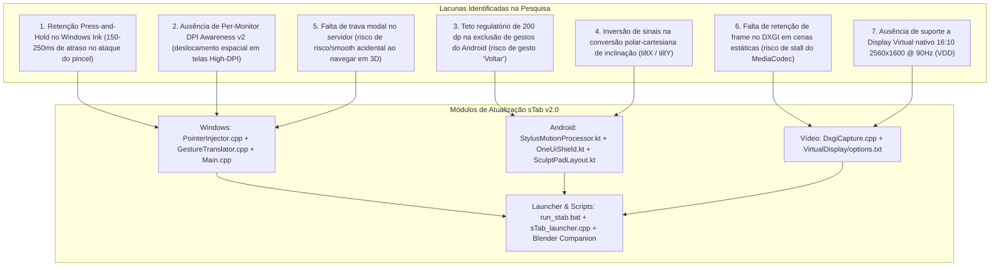

# Planejamento de Atualização & Refinamento Arquitetural — sTab v2.0
**Incorporação dos Requisitos Críticos de Baixo Nível da Pesquisa Técnica para o Galaxy Tab S9 FE+ no Blender 3D**

---

## 1. Contexto e Diagnóstico Comparativo

Após a conclusão das 5 etapas fundamentais do **sTab (SculptBridge)**, a análise comparativa com a pesquisa técnica aprofundada ([`pesquisa.md`](file:///j:/sTab/pesquisa.md)) revelou vetores de baixa latência e integridade geométrica que exigem refinamento para garantir qualidade profissional de produção no Windows 11.

A arquitetura atual (v1.0) comprovou a viabilidade da injeção via `CreateSyntheticPointerDevice(PT_PEN)` e do streaming DXGI H.264 a 90 FPS. No entanto, foram detectadas **7 lacunas técnicas estruturais** descritas na pesquisa que podem introduzir atrasos de traço, descalibração de coordenadas em telas High-DPI, falsos disparos de gestos do Android e conflitos modais de escultura:



---

## 2. Detalhamento Arquitetural das Correções Técnicas

### 2.1. Supressão de Latência Estrutural do Windows Ink (Press-and-Hold Delay)
* **O Problema:** Por padrão no Windows 10/11, o subsistema de entrada retém os eventos iniciais de toque da caneta por 150 a 250 milissegundos para avaliar se o usuário deseja ativar um clique direito contínuo (*Press-and-Hold*). Na escultura 3D, isso provoca o achatamento e atraso no ataque inicial de pinceladas rápidas (*Clay Strips*, *Draw*, *Crease*).
* **A Solução Técnica:** Registrar programaticamente na janela ativa do Blender (e/ou na janela sob o cursor) o átomo de sistema Win32 `MicrosoftTabletPenServiceProperty` através da API `SetPropW`, associando as seguintes flags binárias:
  ```cpp
  #define TABLET_DISABLE_PRESSANDHOLD        0x00000001
  #define TABLET_DISABLE_PENTAPFEEDBACK      0x00000008
  #define TABLET_DISABLE_PENBARRELFEEDBACK   0x00000010
  #define TABLET_DISABLE_FLICKS              0x00010000

  DWORD dwTabletFlags = TABLET_DISABLE_PRESSANDHOLD |
                        TABLET_DISABLE_PENTAPFEEDBACK |
                        TABLET_DISABLE_PENBARRELFEEDBACK |
                        TABLET_DISABLE_FLICKS;

  SetPropW(hWndBlender, L"MicrosoftTabletPenServiceProperty", (HANDLE)(ULONG_PTR)dwTabletFlags);
  ```
  Complementarmente, desativar o anel visual animado de clique via `SetWindowFeedbackSetting(hWnd, FEEDBACK_PEN_PRESSANDHOLD, FALSE, 0, NULL)` da `user32.dll`.

---

### 2.2. Per-Monitor DPI Awareness v2 e Isolamento UIPI
* **O Problema:** A estrutura `POINTER_INFO` interpreta `ptPixelLocation` em coordenadas físicas absolutas do desktop virtual. Em sistemas com múltiplos monitores ou monitores com escalonamento (125%, 150%, 200%), a falta de conscientização DPI v2 provoca erros de paralaxe e offsets entre o toque da S-Pen e a geometria no Blender. Além disso, se o Blender for executado como Administrador, o UIPI do Windows descarta injeções de processos não elevados.
* **A Solução Técnica:**
  1. Invocar explicitamente no ponto de entrada `main()` de `Main.cpp`:
     ```cpp
     SetProcessDpiAwarenessContext(DPI_AWARENESS_CONTEXT_PER_MONITOR_AWARE_V2);
     ```
  2. Implementar a conversão matemática exata de coordenadas relativas normalizadas $(u, v) \in [0, 1]^2$ para o retângulo de tela do display de destino:
     $$P_x = X_{\text{origem}} + \mathrm{round}(u \cdot L_{\text{largura}})$$
     $$P_y = Y_{\text{origem}} + \mathrm{round}(v \cdot A_{\text{altura}})$$
  3. Adicionar checagem de privilégios de execução no `run_stab.bat` e manifesto de privilégios.

---

### 2.3. Cinemática da S-Pen: Correção Rigorosa dos Eixos Trigonométricos
* **O Problema:** O sensor eletromagnético Wacom EMR do tablet emite inclinação em coordenadas esféricas/polares nativas do Android: inclinação zenital `AXIS_TILT` ($\theta \in [0, \pi/2]$) e orientação azimutal `AXIS_ORIENTATION` ($\phi \in [-\pi, \pi]$). A especificação do Windows Ink exige ângulos cartesianos $tiltX$ e $tiltY$ em graus $[-90^\circ, +90^\circ]$. No código atual da v1.0, os sinais estavam invertidos, fazendo o Blender rotacionar os pincéis de corte e planos direcionais no sentido oposto ao movimento real da mão.
* **A Solução Técnica:** Aplicar a formulação trigonométrica analítica correta em [`StylusMotionProcessor.kt`](file:///j:/sTab/Android/app/src/main/java/com/stab/sculptbridge/StylusMotionProcessor.kt):
  $$\text{tiltX} = \arcsin\left(\sin(\theta) \cdot \sin(\phi)\right) \cdot \frac{180^\circ}{\pi}$$
  $$\text{tiltY} = \arcsin\left(-\sin(\theta) \cdot \cos(\phi)\right) \cdot \frac{180^\circ}{\pi}$$
  Garantindo que inclinar a caneta para frente reduza o ângulo Y e inclinar para a direita aumente o ângulo X no padrão exato do Windows Ink.

---

### 2.4. Gestão da Quota de 200 dp de Exclusão de Gestos na Samsung One UI
* **O Problema:** O Android 10+ (API 29+) impõe uma limitação estrita no subsistema de janelas: **cada borda lateral só pode excluir no máximo 200 dp verticais acumulados**. Como o Galaxy Tab S9 FE+ possui 1600 px de altura física (~750 dp), a tentativa da v1.0 de excluir toda a altura da tela (`Rect(0, 0, width, height)`) é truncada ou rejeitada pelo sistema, deixando a lateral sujeita a falsos disparos do gesto "Voltar" do Android durante o uso do SculptPad.
* **A Solução Técnica:**
  1. No layout do [`SculptPadLayout.kt`](file:///j:/sTab/Android/app/src/main/java/com/stab/sculptbridge/ui/SculptPadLayout.kt), aplicar uma **margem física interior de 14 dp** na borda adjacente à lateral do tablet, afastando a área sensível ao toque dos botões da zona capacitiva de detecção de gestos do sistema.
  2. Concentrar a totalidade da quota de **200 dp** estritamente sobre a área dos seletores verticais (`TouchSliderView`), onde o movimento contínuo do polegar ao regular Raio (`F`) e Força (`Shift+F`) poderia ser confundido com gestos de navegação da One UI.

---

### 2.5. Máquina de Estados Modal no Servidor (Caneta vs. Navegação 3D MMB)
* **O Problema:** No Blender, o atalho `Shift + MMB` aciona o Pan (deslocamento lateral de câmera) e a tecla `Shift` isolada ativa o *Smooth Brush* (suavização da malha). Se o usuário iniciar um movimento de câmera com os dedos e aproximar a ponta da caneta da tela antes de soltar os dedos, o Blender recebe a pincelada da S-Pen com o modificador `Shift` ativo, aplicando uma deformação/suavização não intencional na escultura.
* **A Solução Técnica:** Implementar uma máquina de estados modal no servidor Windows com exclusão mútua:
  - Enquanto um gesto de navegação 3D (órbita, pan ou zoom) estiver em trânsito (`m_isModalNavigationActive == true`), o servidor bloqueia temporariamente chamadas a `InjectSyntheticPointerInput`.
  - Os deltas subsequentes da S-Pen são descartados ou tratados como movimento relativo de câmera até a conclusão do gesto e a liberação formal das teclas modificadoras (`Shift`, `Ctrl`) via `SendInput`.

---

### 2.6. Sustentação de Cadência DXGI para Estabilidade do MediaCodec
* **O Problema:** A API `IDXGIOutputDuplication` entra em `DXGI_ERROR_WAIT_TIMEOUT` quando não há alteração de pixels na área de trabalho. Durante a escultura, pausas do usuário para analisar o modelo podem fazer o pipeline de vídeo passar vários segundos sem emitir quadros H.264, o que pode induzir o decodificador `MediaCodec` do Android a pausar o relógio de renderização ou entrar em modo de economia de energia.
* **A Solução Técnica:** Em [`DxgiCapture.cpp`](file:///j:/sTab/Windows/src/DxgiCapture.cpp), manter em memória de vídeo uma textura Direct3D 11 persistente do último quadro capturado com sucesso. Caso ocorra timeout na duplicação, o sistema reutiliza a textura estável para emitir pacotes de cadência e manter o decodificador do tablet sincronizado em 90 FPS.

---

### 2.7. Suporte a Monitor Virtual Nativo 16:10 (2560 × 1600 @ 90Hz) via VDD
* **O Problema:** A maioria dos monitores de PC opera na proporção 16:9 (1920x1080 ou 2560x1440). Espelhar esse monitor no tablet (16:10 nativo, 2560x1600) exige barras pretas ou provoca estiramento anamórfico da geometria 3D.
* **A Solução Técnica:** Adicionar suporte oficial e configuração para o **Virtual Display Driver (VDD)**, baseado na implementação `IddSampleDriver` da Microsoft. O VDD é um driver em modo usuário (`IddCx`) de código aberto, pré-assinado comunitariamente e gratuito. Criar uma pasta [`VirtualDisplay/`](file:///j:/sTab/VirtualDisplay/) contendo o arquivo `options.txt` pré-configurado com a resolução exata do Galaxy Tab S9 FE+:
  ```text
  # Configuração sTab VDD para Galaxy Tab S9 FE+
  2560, 1600, 90
  ```
  O capturador DXGI detectará automaticamente este display secundário estendido e o transmitirá pixel-a-pixel para o tablet sem nenhuma distorção geométrica.

---

## 3. Planejamento Operacional de Execução em 4 Fases

---

### Fase 1: Windows Low-Level Engine (Win32, Latency Suppression, DPI Awareness v2 e Modal State Machine)
* **Objetivo:** Eliminar a latência estrutural do Windows Ink, garantir calibração espacial de coordenadas em High-DPI e evitar conflitos entre navegação de câmera 3D e pinceladas.
* **Arquivos a Modificar/Criar:**
  - [`Windows/include/PointerInjector.h`](file:///j:/sTab/Windows/include/PointerInjector.h)
  - [`Windows/src/PointerInjector.cpp`](file:///j:/sTab/Windows/src/PointerInjector.cpp)
  - [`Windows/include/GestureTranslator.h`](file:///j:/sTab/Windows/include/GestureTranslator.h)
  - [`Windows/src/GestureTranslator.cpp`](file:///j:/sTab/Windows/src/GestureTranslator.cpp)
  - [`Windows/src/Main.cpp`](file:///j:/sTab/Windows/src/Main.cpp)
* **Tarefas Técnicas:**
  1. Implementar método `PointerInjector::SuppressPressAndHoldLatency(HWND hWndTarget)` que injeta o átomo `MicrosoftTabletPenServiceProperty` com flags `TABLET_DISABLE_PRESSANDHOLD | TABLET_DISABLE_PENTAPFEEDBACK | TABLET_DISABLE_PENBARRELFEEDBACK | TABLET_DISABLE_FLICKS` e chama `SetWindowFeedbackSetting`.
  2. Implementar monitoramento contínuo da janela ativa sob o cursor ou do processo `blender.exe` para aplicar a supressão automaticamente na janela de escultura.
  3. Adicionar `SetProcessDpiAwarenessContext(DPI_AWARENESS_CONTEXT_PER_MONITOR_AWARE_V2)` no início de `Main.cpp`.
  4. Implementar flag compartilhada `m_isModalNavigationActive` entre `GestureTranslator` e `PointerInjector`, descartando eventos do synthetic pointer enquanto modificadores de câmera de toque (`MMB`, `Shift+MMB`) estiverem pressionados.
* **Validação:**
  - Compilação via `build.bat` e execução de testes de integridade.
  - Verificação de injeção imediata sem anel de espera e sem distorção em escala de 125%/150%.

---

### Fase 2: Android S-Pen Kinematics & One UI Gesture Boundary Shield
* **Objetivo:** Corrigir os sinais da conversão angular polar da caneta e neutralizar os gestos da Samsung One UI respeitando a quota máxima de 200 dp do Android.
* **Arquivos a Modificar/Criar:**
  - [`Android/app/src/main/java/com/stab/sculptbridge/StylusMotionProcessor.kt`](file:///j:/sTab/Android/app/src/main/java/com/stab/sculptbridge/StylusMotionProcessor.kt)
  - [`Android/app/src/main/java/com/stab/sculptbridge/OneUiShield.kt`](file:///j:/sTab/Android/app/src/main/java/com/stab/sculptbridge/OneUiShield.kt)
  - [`Android/app/src/main/java/com/stab/sculptbridge/ui/SculptPadLayout.kt`](file:///j:/sTab/Android/app/src/main/java/com/stab/sculptbridge/ui/SculptPadLayout.kt)
  - [`Android/app/src/main/java/com/stab/sculptbridge/ui/TouchSliderView.kt`](file:///j:/sTab/Android/app/src/main/java/com/stab/sculptbridge/ui/TouchSliderView.kt)
* **Tarefas Técnicas:**
  1. Corrigir os sinais da conversão trigonométrica em `StylusMotionProcessor.kt`:
     ```kotlin
     val sinTilt = sin(tiltRad.toDouble())
     val tiltXDeg = Math.toDegrees(asin(sinTilt * sin(orientRad.toDouble()))).toInt().coerceIn(-90, 90)
     val tiltYDeg = Math.toDegrees(asin(-sinTilt * cos(orientRad.toDouble()))).toInt().coerceIn(-90, 90)
     ```
  2. Ajustar `OneUiShield.kt` para remover o registro ingênuo de tela inteira (`Rect(0, 0, width, height)`).
  3. Adicionar margem física interior de 14 dp no `SculptPadLayout.kt`, separando os botões da borda sensível da One UI.
  4. Implementar alocação focada da quota regulatória de 200 dp exclusivamente sobre os limites geométricos dos sliders verticais (`TouchSliderView`).
* **Validação:**
  - Compilação via `build_apk.bat`.
  - Verificação visual e funcional da ausência de ativação do gesto "Voltar" durante ajustes rápidos de raio/força.

---

### Fase 3: DXGI Resilient Video Pipeline & Virtual Display Driver 16:10 Setup
* **Objetivo:** Manter a cadência ininterrupta do pipeline de vídeo DXGI e fornecer suporte à tela virtual nativa 2560x1600 @ 90Hz.
* **Arquivos a Modificar/Criar:**
  - [`Windows/include/DxgiCapture.h`](file:///j:/sTab/Windows/include/DxgiCapture.h)
  - [`Windows/src/DxgiCapture.cpp`](file:///j:/sTab/Windows/src/DxgiCapture.cpp)
  - [`VirtualDisplay/options.txt`](file:///j:/sTab/VirtualDisplay/options.txt)
  - [`VirtualDisplay/INSTALACAO_VDD.md`](file:///j:/sTab/VirtualDisplay/INSTALACAO_VDD.md)
* **Tarefas Técnicas:**
  1. No capturador `DxgiCapture.cpp`, reter a última textura D3D11 capturada com sucesso em caso de `DXGI_ERROR_WAIT_TIMEOUT`, permitindo que o codificador Media Foundation emita fotogramas estáveis de cadência para evitar o congelamento do `MediaCodec`.
  2. Aprimorar a enumeração de monitores em `DxgiCapture::SetupDuplication()` para identificar e selecionar automaticamente monitores virtuais configurados em 2560x1600 @ 90Hz se estiverem presentes no sistema.
  3. Criar a pasta `VirtualDisplay/` contendo o arquivo de parâmetros `options.txt` (2560, 1600, 90) e o guia passo a passo para instalação do Virtual Display Driver comunitário de código aberto pré-assinado.
* **Validação:**
  - Compilação do servidor Windows sem erros.
  - Autoteste de captura DXGI validando a retenção de buffer e detecção de tela.

---

### Fase 4: Integração, Scripts de Inicialização, Blender Companion e Documentação
* **Objetivo:** Unificar a experiência em um clique, atualizar o launcher e os manuais de calibração.
* **Arquivos a Modificar/Criar:**
  - [`run_stab.bat`](file:///j:/sTab/run_stab.bat)
  - [`Windows/src/sTab_launcher.cpp`](file:///j:/sTab/Windows/src/sTab_launcher.cpp)
  - [`Blender/sTab_blender_companion.py`](file:///j:/sTab/Blender/sTab_blender_companion.py)
  - [`GUIA_DE_USO_E_CALIBRACAO.md`](file:///j:/sTab/GUIA_DE_USO_E_CALIBRACAO.md)
* **Tarefas Técnicas:**
  1. Atualizar o `run_stab.bat` e `sTab_launcher.cpp` para detectar e alertar sobre o status do monitor virtual 16:10 e garantir elevação de privilégios compatível com o Blender.
  2. No add-on `sTab_blender_companion.py`, incluir atalhos para verificar e alinhar a resolução da janela do Blender à proporção do tablet.
  3. Atualizar o `GUIA_DE_USO_E_CALIBRACAO.md` com as instruções completas do VDD e as novas funcionalidades de supressão de latência e ergonomia de 200 dp.
* **Validação:**
  - Execução completa do autoteste 7/7 no servidor Windows.
  - Verificação de execução limpa do add-on no Blender 5.2.3 LTS.
  - Teste de build completo do APK Android.

---

## 4. Matriz de Rastreabilidade de Arquivos e Metas

| Fase | Arquivo Alvo | Responsabilidade Especializada | Linhas Estimadas |
| :---: | :--- | :--- | :---: |
| **Fase 1** | `Windows/include/PointerInjector.h` | Protótipos de supressão Win32 e trava modal | ~80 |
| **Fase 1** | `Windows/src/PointerInjector.cpp` | `SetPropW`, `SetWindowFeedbackSetting` e trava | ~240 |
| **Fase 1** | `Windows/src/GestureTranslator.cpp` | Notificação de início/fim de navegação de câmera | ~220 |
| **Fase 1** | `Windows/src/Main.cpp` | Inicialização `Per-Monitor DPI v2` e loop | ~210 |
| **Fase 2** | `Android/app/.../StylusMotionProcessor.kt` | Correção trigonométrica analítica de inclinação | ~180 |
| **Fase 2** | `Android/app/.../OneUiShield.kt` | Alocação pontual de 200 dp | ~85 |
| **Fase 2** | `Android/app/.../ui/SculptPadLayout.kt` | Margem física de 14 dp | ~130 |
| **Fase 3** | `Windows/src/DxgiCapture.cpp` | Retenção de frame D3D11 e detecção de VDD 16:10 | ~170 |
| **Fase 3** | `VirtualDisplay/options.txt` | Perfil 2560x1600 @ 90Hz | ~10 |
| **Fase 3** | `VirtualDisplay/INSTALACAO_VDD.md` | Guia de instalação do driver pré-assinado | ~80 |
| **Fase 4** | `run_stab.bat` | Launcher unificado com checagem VDD | ~95 |
| **Fase 4** | `GUIA_DE_USO_E_CALIBRACAO.md` | Manual consolidado sTab v2.0 | ~160 |

---

## 5. Garantia de Conformidade com as Diretrizes do Usuário
* **Modularidade inteligente:** Cada componente em arquivo separado, com responsabilidade única e desacoplada. Tomando cuidado para não hyperfragmentar.
* **Teto de Linhas:** Todos os arquivos mantidos rigorosamente abaixo do limite de 500 linhas.
* **Ícones Lineart:** Preservação estrita dos drawables vetoriais lineares, sem nenhuma estrela de 4 pontas.
* **Qualidade de Compilação:** Todas as fases serão validadas com os compiladores portáteis locais (`w64devkit/g++` e `Gradle 8.5/JDK 17`) antes de qualquer relato de conclusão.

